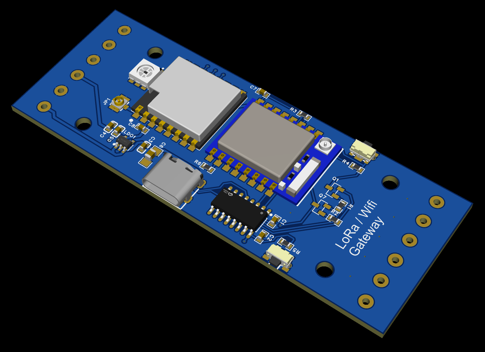

# Esp8266-LoRa-Gateway

[](https://github.com/kbittle/Esp8266-LoRa-Gateway/actions/workflows/build.yml)

Custom PCB and software for WiFi(ESP8266) to LoRa(Ra-01H) gateway. This is meant to fit in a [DMB-4770 enclosure](https://www.digikey.com/en/products/detail/bud-industries/DMB-4770/2499326?gclsrc=aw.ds&gad_source=1&gad_campaignid=17922795960&gbraid=0AAAAADrbLliLALWqXMvqAjymSpm62XcV1&gclid=Cj0KCQjw94bTBhDQARIsAN3vv0ymIrAf8-c34imw-3O3CEBacBJsq8vE9WuR0ZiFMQMXCZOAnRCBhwAaAlsuEALw_wcB).



## 📁 Repository Structure

```text
Esp8266-LoRa-Gateway/
├── docker/                  # Files to build docker container
├── docs/                    # Datasheets, schematics, and reference manuals
├── esp-gateway-project/     # ESP8266 Project
|    ├── build               # Build output folder
|    └── main                # Source files
└── gerbers/                 # PCB Fab files
```

## 🔌 Hardware Pinout

The PCB bridges the **ESP8266**, an **Ai-Thinker Ra-01H LoRa Module** (SX127X), and an **SK9822 RGB LED** indicator.

### 📡 Ra-01 LoRa Module (SPI)

| ESP8266 GPIO | NodeMCU Pin | Ra-01 Pin | Function |
| :--- | :--- | :--- | :--- |
| **GPIO 14** | D5 | SCK | SPI Clock |
| **GPIO 12** | D6 | MISO | SPI Master In Slave Out |
| **GPIO 13** | D7 | MOSI | SPI Master Out Slave In |
| **GPIO 5** | D1 | NSS / CS | Chip Select |
| **GPIO 4** | D2 | RST | Hardware Reset |

### 💡 SK9822 Addressable RGB LED

| ESP8266 GPIO | NodeMCU Pin | SK9822 Pin | Function |
| :--- | :--- | :--- | :--- |
| **GPIO 2** | D4 | DATA | Serial Data Input |
| **GPIO 16** | D0 | CLK | Serial Clock Input |

## 📖 Developer Guides

* **💻 [SW Dev Environment Setup](docs/build-instructions.md)** — Build instructions
* **⚡ [FW Loading Instructions](docs/flash-instructions.md)** — Firmware Loading instructions

## 📡 MQTT Topics

Base topic: `lora/gateway/<gateway_id>/` (default: `lora/gateway/01/`)

Configure `gateway_id` in the web UI (MQTT Config tab).

### Published by Gateway

| Topic | Direction | Description | Retained |
|-------|-----------|-------------|:--------:|
| `status` | GW → Broker | System status (uptime, heap, wifi, LoRa stats) | No |
| `status/connection` | GW → Broker | `online`/`offline` (LWT) | **Yes** |
| `rx` | GW → Broker | Received LoRa packet (hex payload, rssi, snr, len, ts) | No |
| `config/get/response` | GW → Broker | Full or partial config response | No |

### Subscribed by Gateway

| Topic | Direction | Description |
|-------|-----------|-------------|
| `config/set` | Broker → GW | Partial config update (JSON) |
| `cmd/+` | Broker → GW | Commands: `reboot`, `factory_reset` |

### Example Payloads

**Status** (published every 30s):
```json
{
  "uptime": 3600,
  "heap": 42,
  "wifi_connected": true,
  "ip": "192.168.1.50",
  "lora_freq": 915,
  "lora_power": 14,
  "lora_sf": 7,
  "rx_count": 120,
  "tx_count": 15,
  "crc_err": 2,
  "tx_timeout": 0,
  "init_fail": 0,
  "mqtt_pub": 120
}
```

**RX Packet**:
```json
{
  "payload": "48656C6C6F",
  "rssi": -42,
  "snr": 9,
  "len": 5,
  "ts": 1700000000
}
```

**Config Set** (send to `lora/gateway/01/config/set`):
```json
{ "lora": { "sf": 9, "power": 20 } }
```

**Commands** (send to `lora/gateway/01/cmd/reboot`):
- `reboot` — Restart the gateway
- `factory_reset` — Reset to defaults (not yet implemented)

### Config Sections

Request specific config by subscribing to `config/get/response` and publishing to `config/get` with:
```json
{ "section": "lora|mqtt|wifi|led|all" }
```

